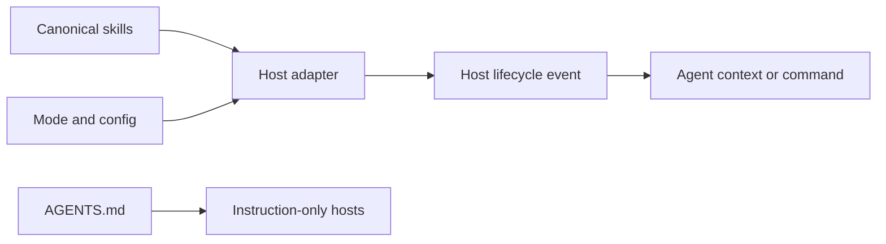

# Architecture

CodeCraft is the display name for this derivative. Hosts expose `/codecraft*` commands and skills; the original `ponytail` commands and config paths remain aliases so existing installs keep working.

## Instruction flow

- `skills/` contains the canonical mode guidance and task skills.
- `AGENTS.md` is the compact always-on copy. `scripts/check-rule-copies.js` checks generated host copies against it.
- `hooks/ponytail-config.js` resolves mode and config values. Lifecycle scripts load and filter the skill for hosts that support hooks.
- `__init__.py` is the Hermes Python adapter. It registers skills, lifecycle hooks, and slash commands; its default mode comes from the environment, then the config file, then `full`.
- `pi-extension/` and `.opencode/` adapt the same guidance and commands to their respective host APIs.
- `commands/` and `.opencode/command/` hold host-specific command prompts. They expose CodeCraft names plus the original Ponytail aliases.
- `tools/codecraft_python_audit.py` is a separate, read-only Python AST scanner. It emits stable text or JSON findings and does not participate in agent startup.

## Language and instruction map

- JavaScript (`.js`/`.mjs`) implements lifecycle hooks, host adapters, scripts, and the Node benchmark harness.
- TypeScript and TSX (`.ts`/`.tsx`) implement the task-board CSV parser, metrics, hook, and UI. The host supplies the TSX runtime for the hook.
- Python implements the Hermes adapter (`__init__.py`), benchmark scorers and runners (`benchmarks/`), and the standalone source auditor (`tools/`).
- Shell scripts include the POSIX status line (`hooks/ponytail-statusline.sh`); a PowerShell status-line counterpart is also provided. These are host utilities, not a shell-based application backend.
- Agent instructions live in `AGENTS.md`, canonical skill files under `skills/`, and generated or host-specific copies in directories such as `.claude-plugin/`, `.cursor/`, `.opencode/`, and `.openclaw/`.

## Task board data flow

Claude Code hook events provide task metadata to `hooks/band/register.tsx`. The hook writes local CSV rows; `hooks/band/board.ts` parses those rows and returns a standalone HTML page. `hooks/ponytail-band-import.js` can add past Claude Code sessions to the same ledger. No database or server is required. A webhook is an optional explicit export path.

The importer reads JSONL transcripts line by line and keeps only fields used by the metrics. Malformed records are skipped. CSV values shown in the board are escaped before insertion into HTML.

## Trust boundaries and limits

- The correctness benchmark runs generated Python or JavaScript code as the current user. Its child process has a private temporary working directory and a reduced environment, but this is **not** an operating-system sandbox. Do not run it on untrusted model output.
- The task board's optional webhook sends selected ledger data to the configured endpoint. Keep its URL and token private; a token should be configured through the host's sensitive setting.
- Hermes mode state is process-local. In a shared gateway, use the host's slash-command access controls.
- Agent behavior and plugin activation still depend on the host application and its version.
- The checked-in TSX board test uses `claude-code/testing`; it is not part of `npm test` and needs the Claude Code test host/runtime. The rest of the Node suite does not require that host.

